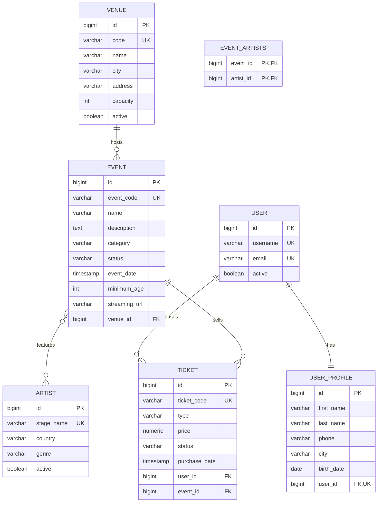

# PulsePass — Plataforma de Gestión de Eventos y Entradas

Plataforma integral de descubrimiento de eventos y gestión de entradas.  
*Arquitectura modular en capas construida con Spring Boot 4, Java 21, JPA/Hibernate, Flyway, Testcontainers y MockMvc.*

---

## 1. Descripción del Proyecto
PulsePass implementa una arquitectura limpia desacoplada en capas:
- **Capa de Controladores REST (`controller`)**: Endpoints HTTP RESTful conformes a contratos OpenAPI/JSON, con validación de entradas `@Valid`, control centralizado de excepciones y mapeo a DTO records.
- **Capa de Servicios de Negocio (`service`)**: Reglas de negocio estrictas, control transaccional `@Transactional`, validaciones de capacidad y concurrencia.
- **Capa de Persistencia (`repository` / `domain`)**: Integridad relacional en PostgreSQL mediante migraciones Flyway y mapeo JPA/Hibernate estricto.

---

## 2. Stack Tecnológico
- **Lenguaje:** Java 21
- **Framework:** Spring Boot 4.1.1
- **Web MVC:** Spring MVC (`spring-boot-starter-web`) + Bean Validation (`spring-boot-starter-validation`)
- **Persistencia:** Spring Data JPA / Hibernate ORM
- **Base de Datos:** PostgreSQL
- **Control de Versiones de BD:** Flyway
- **Pruebas:**
  - Controladores: JUnit 5 + Mockito + `@WebMvcTest` + MockMvc (`spring-boot-starter-webmvc-test`)
  - Servicios: JUnit 5 + Mockito + AssertJ
  - Persistencia: Testcontainers + PostgreSQL real + Dynamic Properties
- **Build Tool:** Maven (vía Maven Wrapper `mvnw`)

---

## 3. Arquitectura y Capa de Controladores REST

### 3.1. Principios de Diseño
- **Inyección por Constructor**: Todos los controladores y servicios utilizan inyección obligatoria por constructor (`final`).
- **Uso estricto de DTO Records**: Ni los controladores ni los clientes manipulan entidades JPA directamente. La entrada y salida se realiza exclusivamente mediante Java `record`.
- **Manejo Centralizado de Excepciones**: No se emplean bloques `try-catch` dentro de los endpoints. Todas las excepciones son capturadas de manera uniforme por `GlobalExceptionHandler` (`@RestControllerAdvice`).
- **Bean Validation**: Anotaciones declarativas (`@NotBlank`, `@NotNull`, `@Email`, `@Size`, `@Min`) en los DTOs de entrada.

### 3.2. Catálogo de Endpoints REST

| Módulo | Método | Endpoint | Descripción | Código Éxito | Códigos Error |
|---|---|---|---|---|---|
| **Venues** | `GET` | `/api/venues/{code}` | Consulta recinto por código | `200 OK` | `404 Not Found` |
| | `GET` | `/api/venues/active` | Lista recintos activos | `200 OK` | — |
| **Events** | `POST` | `/api/events` | Registra un nuevo evento en estado `DRAFT` | `201 Created` | `400 Bad Request`, `404 Not Found` |
| | `GET` | `/api/events/{eventCode}` | Consulta evento por código | `200 OK` | `404 Not Found` |
| | `GET` | `/api/events/published` | Lista eventos publicados cronológicamente | `200 OK` | — |
| | `PATCH` | `/api/events/{eventCode}/publish` | Publica un evento validando reglas de negocio | `200 OK` | `404 Not Found`, `409 Conflict` |
| | `POST` | `/api/events/{eventCode}/artists/{artistId}` | Asocia un artista activo a un evento | `200 OK` | `404 Not Found`, `409 Conflict` |
| | `GET` | `/api/events/by-artist?stageName=` | Filtra eventos por nombre de artista | `200 OK` | — |
| **Artists** | `GET` | `/api/artists/{id}` | Consulta artista por ID | `200 OK` | `404 Not Found` |
| | `GET` | `/api/artists/by-stage-name?stageName=` | Consulta artista por nombre artístico | `200 OK` | `404 Not Found` |
| | `GET` | `/api/artists/active` | Lista artistas activos | `200 OK` | — |
| **Users** | `POST` | `/api/users` | Registra un usuario y su perfil | `201 Created` | `400 Bad Request`, `409 Conflict` |
| | `GET` | `/api/users/by-email?email=` | Consulta usuario por correo electrónico | `200 OK` | `404 Not Found` |
| | `GET` | `/api/users/by-username?username=` | Consulta usuario por nombre de usuario | `200 OK` | `404 Not Found` |
| **Tickets** | `POST` | `/api/tickets` | Compra y emisión de ticket validando reglas | `201 Created` | `400 Bad Request`, `404 Not Found`, `409 Conflict` |
| | `GET` | `/api/tickets/{ticketCode}` | Consulta ticket por código | `200 OK` | `404 Not Found` |
| | `GET` | `/api/tickets/by-user?email=` | Lista tickets adquiridos por un usuario | `200 OK` | — |
| | `GET` | `/api/events/{eventCode}/tickets/paid` | Consulta tickets pagados de un evento | `200 OK` | — |
| | `PATCH` | `/api/tickets/{ticketCode}/cancel` | Cancela un ticket pagado | `200 OK` | `404 Not Found`, `409 Conflict` |
| | `PATCH` | `/api/tickets/{ticketCode}/use` | Marca un ticket pagado como utilizado | `200 OK` | `404 Not Found`, `409 Conflict` |

### 3.3. Estructura Estándar de Respuesta de Error
Todas las respuestas de error siguen el contrato `ErrorResponse`:
```json
{
  "timestamp": "2026-10-11T21:40:00Z",
  "status": 400,
  "error": "Bad Request",
  "message": "Validation failed",
  "details": {
    "email": "must be a well-formed email address"
  }
}
```

---

## 4. Modelo de Dominio y Relacional



---

## 5. Estrategia de Migraciones con Flyway
La base de datos es la dueña de la integridad estructural. Hibernate está configurado en modo:
```yaml
spring.jpa.hibernate.ddl-auto: validate
```
Las migraciones se aplican en orden estricto desde `src/main/resources/db/migration`:
1. **`V1__create_schema.sql`**: Define el esquema base con PKs, FKs, constraints `UNIQUE`, `CHECK` e índices.
2. **`V2__insert_initial_artists.sql`**: Inserta el catálogo inicial de artistas.
3. **`V3__add_streaming_url_to_event.sql`**: Incorpora `streaming_url` a la tabla `events`.

---

## 6. Pruebas Automatizadas

El proyecto cuenta con una cobertura integral de pruebas que incluye:
- **32 Pruebas de Controladores (`@WebMvcTest` + MockMvc)**:
  - `VenueControllerTest` (3 tests)
  - `EventControllerTest` (9 tests)
  - `ArtistControllerTest` (4 tests)
  - `UserControllerTest` (5 tests)
  - `TicketControllerTest` (11 tests)
- **35 Pruebas Unitarias de Servicios (`Mockito` + JUnit 5)**:
  - `VenueServiceImplTest` (3 tests)
  - `EventServiceImplTest` (11 tests)
  - `ArtistServiceImplTest` (4 tests)
  - `UserServiceImplTest` (5 tests)
  - `TicketServiceImplTest` (12 tests)
- **8 Pruebas de Integración de Persistencia (`Testcontainers` + PostgreSQL real)**:
  - `PulsePassPersistenceIntegrationTest`
- **1 Prueba de Contexto de Aplicación**:
  - `PulsepassApplicationTests`

**Total: 76 pruebas automatizadas ejecutadas y aprobadas al 100%.**

---

## 7. Instrucciones de Ejecución

### Prerrequisitos
- Java 21 instalado.
- Docker Desktop en ejecución (requerido para Testcontainers en las pruebas de integración).

### Ejecutar todas las pruebas

**En Windows (PowerShell / CMD):**
```powershell
.\mvnw.cmd clean test
```

**En Linux / macOS:**
```bash
./mvnw clean test
```

### Ejecutar solo las pruebas de controladores (MockMvc)
```powershell
.\mvnw.cmd test -Dtest=*ControllerTest
```
