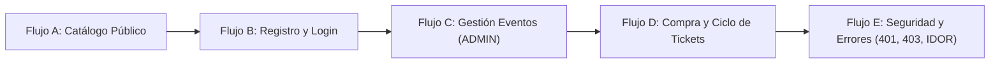

# PulsePass — Suite de Pruebas E2E Manuales (Fase 5)

Este directorio contiene la suite completa de artefactos para la ejecución de **pruebas end-to-end (E2E) manuales de caja negra** sobre los controladores REST y la capa de seguridad de **PulsePass**, según las especificaciones del PRD de Fase 5.

---

## 1. Estructura de Entregables

```text
tests/e2e/
├── README.md                                    # Esta guía operativa
├── checklist-e2e-manual.md                      # Lista de chequeo ordenada (Flujos A al E)
├── registro-ejecucion-manual.md                 # Bitácora de ejecución (PASS/FAIL/BLOCKED)
├── .gitignore                                   # Exclusión de tokens y secretos locales
├── fixtures/
│   ├── README.md                                # Documentación de fixtures y reseteo
│   └── seed-e2e.sql                             # SQL para venues, admin, staff e inactivo
└── postman/
    ├── PulsePass-Manual-E2E.postman_collection.json  # Colección v2.1 (10 carpetas, 0 scripts)
    └── PulsePass-local.postman_environment.json      # Entorno con variables configurables
```

---

## 2. Principios y Reglas de la Fase 5

1. **CERO SCRIPTS:** No se permite el uso de scripts en las pestañas `Pre-request Script` ni `Tests` de Postman, ni librerías como `pm.test()`, `pm.expect()`, ni herramientas automatizadas (Newman o Collection Runner).
2. **Disparo Manual:** Cada solicitud HTTP se envía explícitamente pulsando el botón **Send**.
3. **Gestión Manual de Tokens:** Los tokens JWT emitidos al autenticarse en `POST /api/auth/login` se copian manualmente al entorno (`{{userAToken}}`, `{{userBToken}}`, `{{staffToken}}`, `{{adminToken}}`).
4. **Inspección Visual Humana:** El evaluador analiza el código HTTP, los encabezados y el cuerpo JSON (`VenueResponse`, `EventResponse`, `TicketResponse`, `ErrorResponse`).

---

## 3. Preparación del Entorno (Paso a Paso)

### Paso 1: Asegurar PostgreSQL
1. Verificar que el servicio PostgreSQL esté activo en `localhost:5432`.
2. Crear la base de datos `pulsepass` si no existe:
   ```sql
   CREATE DATABASE pulsepass;
   ```
3. Verificar que las credenciales en `src/main/resources/application.yml` coincidan con tu servidor local.

### Paso 2: Iniciar la Aplicación Backend
Ejecutar desde la raíz del proyecto:
```powershell
.\mvnw.cmd spring-boot:run
```
Al arrancar, **Flyway** creará automáticamente las tablas y aplicará las migraciones `V1` a `V4`.

### Paso 3: Cargar los Fixtures de Datos
Con la base de datos ya estructurada por Flyway, ejecutar el script:
```powershell
psql -h localhost -p 5432 -U postgres -d pulsepass -f tests/e2e/fixtures/seed-e2e.sql
```
*(O copiar y ejecutar el contenido de [`seed-e2e.sql`](file:///tests/e2e/fixtures/seed-e2e.sql) en pgAdmin / DBeaver).*

Esto dejará listos los siguientes usuarios preprovisionados:
* **Admin:** `admin.e2e` / `AdminPass123!` (Roles: `ROLE_ADMIN`, `ROLE_USER`)
* **Staff:** `staff.e2e` / `StaffPass123!` (Roles: `ROLE_STAFF`, `ROLE_USER`)
* **Inactivo:** `inactive.e2e` / `InactivePass123!` (Estado: inactivo)

---

## 4. Configuración en Postman

1. Abrir **Postman** (o la extensión oficial de Postman en Visual Studio Code).
2. Hacer clic en **Import** y cargar ambos archivos ubicados en `tests/e2e/postman/`:
   * `PulsePass-Manual-E2E.postman_collection.json`
   * `PulsePass-local.postman_environment.json`
3. En la esquina superior derecha de Postman, seleccionar el entorno **`PulsePass Local`**.
4. Confirmar que la variable `baseUrl` apunte a `http://localhost:8080`.

---

## 5. Secuencia de Ejecución de las Pruebas

Seguir el orden establecido en [`checklist-e2e-manual.md`](file:///tests/e2e/checklist-e2e-manual.md):



### Flujo A: Catálogo y Descubrimiento (Público)
* Carpeta `00 Preparación / conectividad` y `01 Venues` + `02 Artists`.
* Probar `GET /api/venues/active`, `GET /api/venues/{{venueActiveCode}}`, `GET /api/artists/active`.
* Validar que respondan `200 OK` con las entidades esperadas.

### Flujo B: Registro y Gestión de Identidades
* Carpeta `03 Auth / usuarios`.
* Registrar `USER_A` (`TC-AUTH-001`) y `USER_B` (`TC-AUTH-001b`) con `POST /api/users`.
* Hacer login con `USER_A`, `USER_B`, `STAFF` y `ADMIN`.
* **Muy importante:** Copiar cada `accessToken` recibido en la respuesta JSON y pegarlo en su variable correspondiente del entorno Postman:
  * `accessToken` de USER_A $\rightarrow$ variable `userAToken`
  * `accessToken` de USER_B $\rightarrow$ variable `userBToken`
  * `accessToken` de STAFF $\rightarrow$ variable `staffToken`
  * `accessToken` de ADMIN $\rightarrow$ variable `adminToken`
* Ejecutar las solicitudes de `GET /api/auth/me` para cada actor y validar sus roles.

### Flujo C: Gestión de Eventos (ADMIN)
* Carpeta `05 Events / administración y visibilidad`.
* Crear evento en borrador con ADMIN (`TC-EVT-01`).
* Asociar artista con ADMIN (`TC-EVT-05`).
* Publicar evento con ADMIN (`TC-EVT-04`).
* Comprobar con la consulta pública `GET /api/events/published` que los borradores no se filtran y los publicados sí son visibles.

### Flujo D: Compra y Ciclo de Vida de Tickets
* Carpeta `06 Tickets / compra, consulta y ciclo de vida`.
* `USER_A` compra Ticket 1 (`GENERAL`) y Ticket 2 (`VIP`).
* Copiar los códigos generados a `ticketCancelableCode` y `ticketUsableCode`.
* Probar la consulta propia de tickets por código y por email (`TC-TKT-02`, `TC-TKT-03`).
* El operador `STAFF` consulta la lista de tickets pagados (`TC-TKT-04`).
* `USER_A` cancela su Ticket 1 (`TC-TKT-05`) $\rightarrow$ Pasa a `CANCELLED`.
* `STAFF` valida y usa el Ticket 2 (`TC-TKT-06`) $\rightarrow$ Pasa a `USED`.

### Flujo E: Pruebas Negativas de Seguridad y Manejo de Errores
* Carpeta `07 Seguridad / escenarios negativos` y `08 Validaciones y errores HTTP`.
* **403 Forbidden (Permisos insuficientes):** Probar que `USER_A` no puede crear eventos, publicar eventos ni ver tickets pagados.
* **403 Forbidden (Anti-IDOR y propiedad):** Probar que `USER_B` no puede consultar el perfil de `USER_A`, ni leer su ticket, ni cancelarlo, ni comprar tickets a su nombre.
* **401 Unauthorized:** Probar contraseñas incorrectas, usuarios inexistentes, tokens manipulados o ausentes, y login de usuario inactivo.
* **400 Bad Request:** Probar payloads con formato de email inválido o longitud de contraseña corta.
* **409 Conflict:** Probar registro de usuarios duplicados, y doble cancelación o doble uso de tickets.

---

## 6. Registro de Resultados

A medida que se envía cada solicitud con **Send**, registrar el resultado observado en:
* [`registro-ejecucion-manual.md`](file:///tests/e2e/registro-ejecucion-manual.md): Colocar el código HTTP real obtenido y marcar el estado como `PASS` o `FAIL`.
* [`checklist-e2e-manual.md`](file:///tests/e2e/checklist-e2e-manual.md): Marcar las casillas `[x]` a medida que se completan las etapas.
